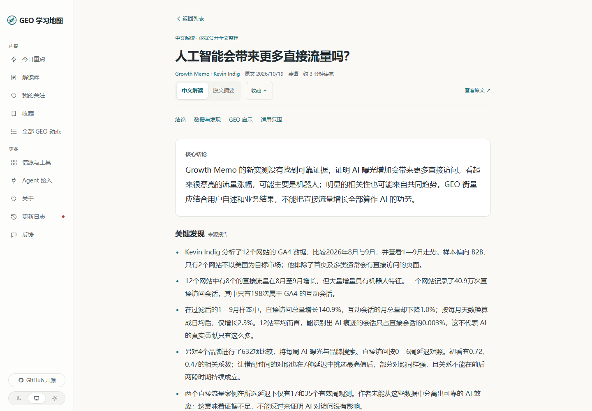

<div align="center">

# GEO 学习地图

**看懂全球 AI 搜索变化，把一手信息变成可用的判断。**

面向 SEO、内容、增长与研究团队的开源中文阅读工作台。

[开始使用](docs/getting-started.md) · [开发接手](docs/handoff.md) · [文档导航](docs/README.md) · [反馈问题](https://github.com/Fangx-AI/geo-learning-map-news/issues)

[](https://github.com/Fangx-AI/geo-learning-map-news/actions/workflows/check.yml)
[](LICENSE)

</div>

<picture>
  <source media="(max-width: 600px)" srcset="docs/assets/geo-today-mobile.png">
  
</picture>

*真实运行界面 · 2026-10-20。截图展示已有内容的阅读体验；开源仓库不附带生产数据库，新部署需要自行采集和补齐解读。*

## 从信息到判断

GEO（Generative Engine Optimization，生成式引擎优化）关注内容如何被 AI 搜索发现、理解与引用。学习地图将分散的官方公告、作者实测和数据研究放进同一条中文阅读路径。

**先找到重点。** 首页优先展示完整、已核读的解读，将近 24 小时变化、今日补齐和历史参考分开，保留原文发布日期。

**再读懂依据。** 阅读页围绕核心结论、关键数据、GEO 启示与适用范围展开；保留原文链接，区分来源发现与本站建议。

**最后回到自己的工作。** 解读库支持按工作问题和关键词查找；关注、收藏与阅读进度保存在当前浏览器，方便接着读。

<details>
<summary>查看中文阅读页</summary>

<picture>
  <source media="(max-width: 600px)" srcset="docs/assets/geo-reader-mobile.png">
  
</picture>

完整解读与来源摘要是两种不同状态。没有取得完整原文时，不用几句导语冒充完整解读；“已核读”也不意味着独立复现过来源的实验。

</details>

## 你可以用它做什么

| 入口 | 适合做什么 |
| --- | --- |
| **今日重点** | 先读结论、选读理由与原文日期 |
| **解读库** | 按工作问题查找完整中文解读 |
| **我的关注** | 跟进关心的领域，查看未读并继续阅读 |
| **日报归档** | 读核读重点，按需展开整期报告 |
| **全部动态 / 全球信源** | 寻找更多线索，筛选出处、导出 OPML |

标题默认进入站内阅读。已有译文可随时切回原文；原始链接始终保留。`/daily` 统一跳转到今日重点，避免两个重复入口。

## 开始使用

**环境：Node.js 24.11+、npm、Git；数据存储使用 PostgreSQL。** Windows 可使用项目提供的本地数据库脚本，服务器可使用 Docker Compose。

```bash
git clone https://github.com/Fangx-AI/geo-learning-map-news.git
cd geo-learning-map-news
npm ci
```

然后按 [首次启动指南](docs/getting-started.md) 完成数据库、网页与公开采集。Windows 初次配置完成后，可用 `./scripts/start-geo.ps1` 恢复服务。

> [!IMPORTANT]
> **启动网站不等于已有内容。** 公开采集和短摘要翻译需要显式开启；完整中文解读需要全文核读后导入，整期日报需要单独配置来源。没有完整解读时，首页可能为空，可先在“全部动态”检查采集结果。基础采集和短摘要翻译不要求付费模型 API。

## 内容如何进入网站

```text
公开订阅 / 网页 / 索引
        ↓
相关性筛选 → 去重与降噪 → 标题、短摘要翻译 → 全部动态
                                                ↓
                                    完整原文核读与证据核对
                                                ↓
                                    中文解读 → 今日重点 / 解读库
```

- **质量优先：** 优先一手研究、实测与平台变化；营销稿、转载和泛 AI 内容降权。来源身份不等于逐篇质量认证。
- **保留依据：** 解读绑定原文版本，原文变化后失效；支持材料保持私有，自动稿不能覆盖已核读内容。
- **持续采集：** 后台守护检查到期信源，记录失败与重试；外部服务限制可能影响覆盖和时效。
- **明确边界：** X、Reddit 等使用可访问的公开入口，不保证平台全量覆盖；小红书暂无稳定免登录自动入口。完整日报的聊天同步依赖另行配置的授权环境。

采集、翻译与解读分开运行。网页打开时不会触发模型生成；质量不稳定的本地小模型概要队列目前保持暂停。配置细节见 [采集与翻译](docs/README.md#采集与翻译)。

## 开发与协作

项目基于 TypeScript、React Router 和 PostgreSQL，采用 npm workspaces。

```text
apps/web/                        网页与阅读交互
apps/api/                        HTTP API
modules/geo-directory/           GEO 采集、翻译、解读与整期日报
packages/backend/src/publication/ 统一公开读取层
industry/                       信源、主题与编辑规则
site/                           品牌、导航与页面文案
```

接手时先读 [开发交接](docs/handoff.md)，按 [贡献指南](CONTRIBUTING.md) 提交改动。页面修改请说明读者的任务，并附桌面、手机效果；纯文档修改检查链接与实际渲染即可。

**目前仍在完善：** 完整解读的覆盖率、采集时效、翻译准确性，以及规则筛选的误收和遗漏。欢迎用具体原文、复现步骤或页面截图提交 [Issue](https://github.com/Fangx-AI/geo-learning-map-news/issues/new)。

## 文档与许可

[完整文档导航](docs/README.md) · [部署与升级](docs/deploy.md) · [阅读产品路径](docs/geo-reading-product.md) · [编辑标准](docs/geo-editorial.md) · [隔离测试](docs/geo-test-local.md)

基于 [AIHOT](https://github.com/KKKKhazix/AIHOT) 定制，感谢上游贡献者。代码沿用 [MIT License](LICENSE)，保留原始版权声明；第三方文章、图片与品牌的权利仍属于各自权利人，详见 [NOTICE](NOTICE)。密钥、生产数据、抓取全文与私人聊天记录不随代码发布。
